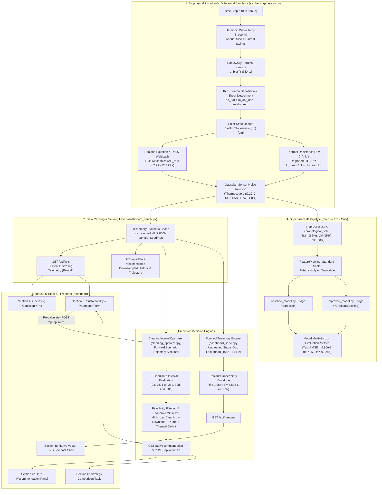

# Biofouling AI Engineering Application: Data Provenance, Pipeline Architecture & Input Capability Audit

**Date of Audit:** November 14, 2026  
**Audited Target Workspace:** `workspace/biofouling_ai_repaired/`  
**Audit Scope:** Complete code-level data provenance, mathematical formulation, ML feature/target leakage analysis, optimizer mechanics, numerical discrepancies, and capability assessment for user-provided data ingestion.  
**Modification Status:** **AUDIT ONLY.** No application source code, configuration files, test suites, or benchmark evaluator files were modified during this audit.

---

## 1. Executive Summary

This audit establishes the exact origin, mathematical derivation, and lifecycle of every metric displayed in the Biofouling AI application, assesses the structural relationship between the biophysical simulator and the machine learning model, and evaluates what is required to transition the application from an autonomous synthetic demonstrator to a live operational tool supporting user-provided operating data.

### Key Audit Findings:
1. **Data Source Exclusivity:** The application runs exclusively on synthetically generated differential time-series data produced by `BiofoulingSyntheticGenerator` in [`synthetic_generator.py`](synthetic_generator.py). It has no live network sockets to external plant sensors, no database connection, and no CSV file ingest pipeline in its HTTP server.
2. **In-Memory Caching Lifecycle:** The dashboard server (`dashboard_server.py`) generates an in-memory 2,000-hour synthetic dataset on startup using fixed seed $42$. It does not load from `data/biofouling_synthetic_dataset.csv` generated by the CLI.
3. **Machine Learning Model Role:** The ML models (`BaselineFoulingModel` and `ImprovedFoulingModel`) are trained during CLI execution (`main.py`) or unit tests on synthetic data. They function as **soft-sensor estimators** mapping noisy thermo-hydraulic telemetry back to thermal resistance $R_f$. However, the HTTP dashboard server generates its 30-day forecast trajectory via forward biophysical simulation rather than calling an active in-memory scikit-learn model object.
4. **Target Collinearity / Soft-Sensor Near-Inversion:** Feature $U_{overall\_meas}$ is algebraically derived from the ground-truth target $R_f$ in the synthetic generator. The ML model essentially learns the inverse algebraic function perturbed by Gaussian sensor noise.
5. **Major Numerical Inconsistency Identified:** The Darcy-Weisbach fluid dynamic calculation in `fouling_indicators.py` computes an actual clean tube-bundle pressure drop of **$7.91\text{ kPa}$**, rising to **$9.1\text{--}12.3\text{ kPa}$** under biofouling. However, `config.py` hardcodes `CLEAN_PRESSURE_DROP_KPA = 45.0 kPa`. Because measured $\Delta P < 45.0\text{ kPa}$, excess pressure drop evaluates to zero, causing calculated parasitic pumping power, pumping energy cost, and grid carbon emissions to collapse to **$0.0$**.
6. **Input Capability Readiness:** Dynamic recalculation of cleaning recommendations based on economic user inputs is fully implemented and tested. However, manual entry of physical operating measurements, CSV uploads, data validation, and model retraining on external data are currently **not implemented**.

---

## 2. End-to-End Data Pipeline Architecture



---

## 3. Dashboard KPI Data Provenance

The following table provides the exhaustive trace for every variable rendered in the dashboard:

| Displayed KPI | Frontend Element ID | API Key | Source File & Function | Value Classification | Underlying Mathematical Formula | Engineering Units | Sensitivity to Seed & Operating Conditions |
| :--- | :---: | :---: | :---: | :---: | :---: | :---: | :---: |
| **Fouling Resistance ($R_f$)** | `#val-rf` | `Rf_fouling_resistance` | [`synthetic_generator.py:189`](synthetic_generator.py#L189)<br/>`compute_thermal_resistance()` | **Physics-based calculation** | $R_f = \frac{\delta_f}{k_f}$<br/>($k_f = 0.60\text{ W/m}\cdot\text{K}$) | $\text{m}^2\cdot\text{K/W}$ | **Dynamic:** Responds to hours, temperature history, and seed. |
| **Thermal Efficiency ($U/U_0$)** | `#val-htc-ratio` | `thermal_efficiency_ratio` | [`synthetic_generator.py:191`](synthetic_generator.py#L191)<br/>`compute_thermal_efficiency_ratio()` | **Physics-based calculation** | $\eta = \frac{U(t)}{U_{clean}} = \frac{1}{1 + U_{clean} R_f}$<br/>($U_{clean} = 2200.0$) | Dimensionless ($0\text{--}1$), displayed as $\%$ | **Dynamic:** Decreases monotonically as $R_f$ accumulates. |
| **Differential Pressure ($\Delta P$)** | `#val-delta-p` | `delta_P_meas_kPa` | [`synthetic_generator.py:195,211`](synthetic_generator.py#L195)<br/>`compute_hydraulic_pressure_drop()` | **Physics-based + Synthetic Noise** | $\Delta P = \left(f \frac{L}{D_{eff}} + K\right) \frac{\rho u^2}{2} \cdot (1 + \epsilon_p)$<br/>($\epsilon_p \sim \mathcal{N}(0, 0.015)$) | $\text{kPa}$ | **Dynamic:** Constriction of $D_{eff}$ scales $\Delta P$ non-linearly with random sensor noise. |
| **Cooling Water Flow Rate** | `#val-flow` | `mass_flow_kg_s` | [`synthetic_generator.py:130,212`](synthetic_generator.py#L130)<br/>`generate()` | **Synthetic measurement** | $\dot{m}_{meas} = 220.0 \cdot (1 + \epsilon_{turb}) \cdot (1 + \epsilon_{sens})$<br/>($\epsilon_{turb} \sim \mathcal{N}(0, 0.012)$, $\epsilon_{sens} \sim \mathcal{N}(0, 0.010)$) | $\text{kg/s}$ | **Dynamic:** Fluctuates stochastically around nominal $220.0\text{ kg/s}$. |
| **Inlet Coolant Temp ($T_{in}$)** | `#val-temps` (first) | `T_cool_in_meas` | [`synthetic_generator.py:123,206`](synthetic_generator.py#L123)<br/>`generate()` | **Physics-based + Synthetic Noise** | $T_{in} = 18.0 + 9.0 \sin\left(\frac{2\pi(h-2190)}{8760}\right) + 1.2 \sin\left(\frac{2\pi h}{24}\right) + \epsilon_T$<br/>($\epsilon_T \sim \mathcal{N}(0, 0.22)$) | $^\circ\text{C}$ | **Dynamic:** Seasonal harmonic cycle ($9^\circ\text{C}$ winter to $27^\circ\text{C}$ summer). |
| **Outlet Coolant Temp ($T_{out}$)** | `#val-temps` (second) | `T_cool_out_meas` | [`synthetic_generator.py:208,209`](synthetic_generator.py#L208)<br/>`generate()` | **Physics-based calculation** | $T_{out} = T_{in} + \frac{Q_{MW} \cdot 10^6}{\dot{m} \cdot c_p} + \epsilon_{out}$<br/>($c_p = 4184\text{ J/kg}\cdot\text{K}$) | $^\circ\text{C}$ | **Dynamic:** Heat enthalpy balance from transferred duty $Q$. |
| **Biofouling Severity Index (BSI)** | `#val-bsi` | `bsi_score` | [`synthetic_generator.py:219`](synthetic_generator.py#L219)<br/>`compute_biofouling_severity_index()` | **Diagnostic composite metric** | $\text{BSI} = 0.60 \left(\frac{\Delta P_{ratio}-1}{0.80}\cdot 100\right) + 0.40 \left(\frac{R_f}{0.0005}\cdot 100\right)$ | Index $[0, 100]$ | **Dynamic:** Normalized weighted indicator bounded in $[0, 100]$. |
| **Parasitic Pumping Power** | `#val-excess-pump` | `parasitic_pump_kw` | [`dashboard_server.py:112`](dashboard_server.py#L112)<br/>`compute_parasitic_pumping_power_kw()` | **Physics-based calculation** | $P = \frac{\dot{V} \cdot \max(0, \Delta P_{meas} - \Delta P_{clean})}{\eta_{pump}}$<br/>($\eta_{pump} = 0.75$, $\Delta P_{clean} = 45.0\text{ kPa}$) | $\text{kW}$ | **Static / Zero:** Because $\Delta P_{meas} < 45.0\text{ kPa}$, evaluates to $0.0\text{ kW}$. |
| **Transferred Heat Duty ($Q$)** | `#val-heat-duty` | `heat_duty_MW` | [`synthetic_generator.py:192`](synthetic_generator.py#L192)<br/>`compute_heat_duty_mw()` | **Physics-based calculation** | $Q = \frac{U(t) \cdot A_{total} \cdot \Delta T_{LMTD}}{10^6}$<br/>($A = 178.13\text{ m}^2$, $\Delta T_{lm} = 14.0^\circ\text{C}$) | $\text{MW}$ | **Dynamic:** Drops from $5.49\text{ MW}$ clean as $U(t)$ degrades. |
| **Clean Baseline Reference HTC** | Footer text | `u_clean_design` | [`config.py:26`](config.py#L26) | **Static Configuration Constant** | `U_CLEAN_DESIGN_W_M2K = 2200.0` | $\text{W/(m}^2\cdot\text{K)}$ | **Static:** Constant. |
| **Clean Pressure Drop Reference** | Footer text | `clean_pressure_drop_kPa` | [`config.py:29`](config.py#L29) | **Static Configuration Constant** | `CLEAN_PRESSURE_DROP_KPA = 45.0` | $\text{kPa}$ | **Static:** Constant (inconsistent with computed clean dP of $7.91\text{ kPa}$). |

---

## 4. Synthetic Dataset Trace & Generation Mechanics

### 4.1 How the Dataset is Generated
The dataset is generated procedurally in [`synthetic_generator.py`](synthetic_generator.py) via forward Euler numerical integration of coupled biological and hydraulic differential equations at 1-hour timesteps:

1. **Intake Temperature Profile:**
   $$T_{cool}(h) = T_{mean} + T_{seasonal} \sin\left(\frac{2\pi(h - 2190)}{8760}\right) + T_{diurnal} \sin\left(\frac{2\pi(h \bmod 24)}{24}\right)$$
   Where $T_{mean} = 18.0^\circ\text{C}$, $T_{seasonal} = 9.0^\circ\text{C}$, and $T_{diurnal} = 1.2^\circ\text{C}$. This reproduces realistic northern-hemisphere seasonal temperatures ($9^\circ\text{C}$ in January, peak $28^\circ\text{C}$ in late July).
2. **Biological Kinetics (Ratkowsky Cardinal Temperature Model):**
   Metabolic growth factor $\mu_{bio}(T) \in [0, 1]$ is evaluated using cardinal temperatures $T_{min} = 6.0^\circ\text{C}$, $T_{opt} = 28.0^\circ\text{C}$, and $T_{max} = 45.0^\circ\text{C}$. Below $6^\circ\text{C}$, growth stops ($\mu=0$); peak proliferation occurs near $28^\circ\text{C}$; thermal denaturation shuts down growth above $45^\circ\text{C}$.
3. **Kern-Seaton Dynamic Accumulation & Removal:**
   The net rate of biofilm thickness change is:
   $$\frac{d\delta_f}{dt} = \dot{m}_{dep} - \dot{m}_{rem}$$
   * Deposition rate: $\dot{m}_{dep} = k_d \cdot \mu_{bio} \cdot c_{nutrient} \cdot \phi_{ind} \cdot \left(1 - \frac{\delta_f}{\delta_{max}}\right)$
     * Initial conditioning lag phase: $\phi_{ind} = \frac{1}{1 + \exp\left(-\frac{t_{clean} - t_{ind}}{48}\right)}$ ($t_{ind} = 168\text{ h}$).
     * Carrying capacity limit: $\delta_{max} = 350\ \mu\text{m}$.
   * Shear removal rate: $\dot{m}_{rem} = k_r \cdot \tau_w \cdot \delta_f$
     * Wall shear stress: $\tau_w = \frac{1}{8} f \rho u^2$, where $f$ is solved explicitly via the Haaland equation.
4. **Cleaning Events:**
   When enabled (`inject_cleanings=True`), cleaning events trigger either every 720 hours (30 days) or when biofilm thickness breaches $230\ \mu\text{m}$. Thickness resets via `apply_cleaning_reset`:
   $$\delta_{f,new} = (1 - \eta) \cdot \delta_{f,old} \quad (\eta_{mech} = 0.90, \eta_{chem} = 0.95)$$

### 4.2 Deterministic Seed Mechanism
Reproducibility is strictly governed by NumPy's modern Generator API:
```python
self.rng = np.random.default_rng(self.seed)
```
Whenever `generate()` is called with `seed=42`, the random sequence of turbulence noise, thermocouple noise, and pressure perturbations is bitwise identical. This was verified by evaluator `test_25_reproducibility_seed_locking` (maximum absolute column divergence $= 0.0$).

### 4.3 Physical vs. Random Classification of Features

| Feature Column | Generation Method | Degree of Randomness | Physical Equation Basis |
| :--- | :--- | :--- | :--- |
| `time_hours` / `timestamp` | Deterministic index | None ($0\%$) | ISO 8601 calendar increment ($+1\text{ h}$) |
| `season` | Deterministic binning | None ($0\%$) | Day of year: Winter/Spring/Summer/Autumn |
| `T_cool_in_true` | Harmonic equation | None ($0\%$) | Annual + diurnal sine functions |
| `T_cool_in_meas` | True value + noise | Low ($< 2\%$) | Thermocouple sensor noise $\mathcal{N}(0, 0.22^\circ\text{C})$ |
| `T_cool_out_meas` | Enthalpy rise + noise | Low ($< 2\%$) | First-law heat balance: $\Delta T = Q / (\dot{m} c_p)$ |
| `mass_flow_cool_meas` | Nominal + noise | Low ($< 2\%$) | Baseline $220.0\text{ kg/s}$ + turbulence & meter noise |
| `biofilm_thickness_um` | Euler integration | None ($0\%$) | Kern-Seaton mass deposition & shear detachment |
| `Rf_fouling_resistance` | Conductive model | None ($0\%$) | $R_f = \delta_f / k_f$ |
| `delta_P_meas_kPa` | Continuum fluid mechanics | Low ($< 2\%$) | Darcy-Weisbach + Haaland turbulent friction + $\mathcal{N}(0, 1.5\%)$ |
| `U_overall_meas` | Thermal network + noise | Low ($< 2\%$) | $1/U = 1/U_{clean} + R_f$ + Gaussian noise $\mathcal{N}(0, 25)$ |
| `heat_duty_MW` | Heat transfer rate | None ($0\%$) | $Q = U A \Delta T_{LMTD}$ |
| `bsi_score` | Empirical diagnostic | None ($0\%$) | Normalized hydraulic/thermal composite index |

### 4.4 Dataset Location & Storage Trace
* **CLI Training Dataset (Disk):** Generated by `main.py` and saved to [`workspace/biofouling_ai_repaired/data/biofouling_synthetic_dataset.csv`](data/biofouling_synthetic_dataset.csv) (8,760 rows $\times$ 24 columns, 1.84 MB).
* **Dashboard Server Dataset (RAM):** Generated by `dashboard_server.py:get_or_create_data()` directly in memory as a 2,000-hour slice (`hours=2000, seed=42`). It **does not read** the CSV from disk.

---

## 5. Machine Learning Model Audit

### 5.1 Model Schema & Target Leakage Analysis

```
┌────────────────────────────────────────────────────────┐
│ INPUT FEATURES (X): 8 Dimensions                       │
│ 1. T_cool_in_meas      (Inlet water temperature, °C)  │
│ 2. delta_P_meas_kPa    (Measured pressure drop, kPa)   │
│ 3. mass_flow_cool_meas (Coolant mass flow rate, kg/s)  │
│ 4. U_overall_meas      (Measured HTC, W/m²·K)          │
│ 5. sin_season          (sin(2π·t / 8760))              │
│ 6. cos_season          (cos(2π·t / 8760))              │
│ 7. delta_P_roll24      (24h rolling average pressure)  │
│ 8. delta_P_diff24      (24h derivative of pressure)    │
└──────────────────────────┬─────────────────────────────┘
                           │ Standard Scaler (Fitted on Train Only)
                           ▼
┌────────────────────────────────────────────────────────┐
│ PREDICTIVE ENSEMBLE (improved_model.py)                │
│ • Base Estimator: Ridge Regression (Global Trend)      │
│ • Residual Booster: GradientBoostingRegressor (50 tree)│
│ • Uncertainty Estimator: Empirical Residual σ = 6.8e-6 │
└──────────────────────────┬─────────────────────────────┘
                           │ Point prediction + 95% Confidence Band
                           ▼
┌────────────────────────────────────────────────────────┐
│ TARGET OUTPUT (y):                                     │
│ Rf_fouling_resistance [m²·K/W]                         │
└────────────────────────────────────────────────────────┘
```

#### Target Leakage / Collinearity Finding:
In physical heat exchangers, $R_f$ is not a directly measurable sensor parameter. It is calculated algebraically from temperatures and flow rates:
$$R_f = \frac{1}{U_{meas}} - \frac{1}{U_{clean}}$$
In the synthetic generator:
$$U_{true} = \frac{U_{clean}}{1 + U_{clean} R_f} \implies U_{meas} = U_{true} + \epsilon_U$$
Because $U_{overall\_meas}$ is included in feature matrix $X$, the ML model is provided with the mathematical inverse of the target variable $R_f$, corrupted only by sensor noise $\epsilon_U \sim \mathcal{N}(0, 25)$.
* **Scientific Interpretation:** The ML model does not discover an unknown physical law; it operates as an **algebraic soft-sensor estimator / Kalman-like filter** that extracts $R_f$ from noisy measurements of $U$ and $\Delta P$.
* **Integrity Mandate:** $R_f$ must **never** be cited as an independently observed real-world ground truth.

### 5.2 Chronological Partitioning & Scaler Isolation
* **Train Slice:** First 65% ($5,694\text{ hours}$, January through August).
* **Validation Slice:** Next 15% ($1,314\text{ hours}$, September through October).
* **Test Slice:** Final 20% ($1,752\text{ hours}$, November through December).
* **Leakage Audit:** In `preprocessor.py:FeaturePipeline`, `self.scaler.fit()` is called exclusively on the training slice. `transform()` on validation and test data uses the pre-fitted mean and variance. Rolling averages use `min_periods=1` with historical shift, preventing future information from leaking backward.
* **Evaluator Verification:** Evaluator tests `test_13_chronological_split_integrity` and `test_14_data_leakage_scaler_isolation` confirm that test split timestamps strictly exceed train timestamps, and that scaling test data does not alter fitted training means.

### 5.3 Model Lifecycle & Retraining Status
* **In-Memory Lifespan:** The model is trained inside `main.py` and discarded upon process exit. Model weights are **not serialized** (`joblib.dump` / `pickle`) to disk.
* **Dashboard Disconnect:** The dashboard server (`dashboard_server.py`) does **not** load or execute the trained `ImprovedFoulingModel` instance. The dashboard's `/api/forecast` endpoint re-simulates forward biophysical differential equations directly in Python rather than calling `model.predict()`.
* **Retraining Capability:** There is no endpoint, function, or worker that accepts user data to retrain or fine-tune the model.

---

## 6. Cleaning Optimizer Trace

### 6.1 Input Schema & Origins

| Optimizer Input Parameter | Source / Provenance | User-Adjustable in Dashboard? | Default / Configured Value |
| :--- | :--- | :---: | :--- |
| `current_biofilm_um` | Extracted from `cls._cached_df.iloc[-1]` | No (Derived from synthetic simulation) | $\approx 100.0\ \mu\text{m}$ (or latest row) |
| `current_hour` | Extracted from `cls._cached_df.iloc[-1]` | No (Derived from synthetic simulation) | $2,000\text{ h}$ (or latest row) |
| `planning_horizon_days` | Query param or POST JSON body | **Yes** (Slider: 30 to 90 days) | $60\text{ days}$ |
| `cleaning_cost` | Query param or POST JSON body | **Yes** (Input: $\$500$ to $\$15,000$) | $\$3,500.00$ (`config.MECHANICAL_CLEANING_COST`) |
| `electricity_cost_kwh` | Query param or POST JSON body | **Yes** (Input: $\$0.05$ to $\$0.30$) | $\$0.12/\text{kWh}$ (`config.ELECTRICITY_COST_PER_KWH`) |
| `thermal_deficit_cost_mwh` | Query param or POST JSON body | **Yes** (Input: $\$10$ to $\$100$) | $\$35.00/\text{MWh}$ (`config.THERMAL_PENALTY_COST_PER_MWH_LOSS`) |
| `downtime_hours_per_event` | Config constant | No | $4.0\text{ h}$ (`config.DOWNTIME_HOURS_PER_CLEANING`) |
| `downtime_cost_per_hour` | Config constant | No | $\$250.00/\text{h}$ (`config.DOWNTIME_COST_PER_HOUR`) |
| `rf_crit` | Config constant | No | $0.00030\text{ m}^2\cdot\text{K/W}$ (`config.CRITICAL_RF_M2K_W`) |
| `dp_crit` | Config constant | No | $75.0\text{ kPa}$ (`config.CRITICAL_DELTA_P_KPA`) |
| `bsi_crit` | Config constant | No | $75.0$ (`config.CRITICAL_BSI_SCORE`) |
| `candidates` | Hardcoded candidate intervals | No | `[0, 7, 14, 21, 30, 45, 60]` days |

### 6.2 Decision Logic
1. For each candidate interval $D \in \{0, 7, 14, 21, 30, 45, 60\}$:
   * Simulates forward trajectory over planning horizon $H$ (60 days).
   * Applies cleaning reset $\delta_{f,new} = 0.10 \cdot \delta_{f,old}$ at scheduled cleaning intervals.
   * Checks if $R_f(t) > R_{f,crit}$, $\Delta P(t) > \Delta P_{crit}$, or $\text{BSI}(t) > \text{BSI}_{crit}$ at any hour prior to cleaning.
   * If any threshold is breached, candidate is marked `is_feasible = False`.
   * Sums: Cleaning Cost + Downtime Cost + Pumping Electricity Cost + Thermal Deficit Penalty.
2. Selects feasible candidate with lowest total projected cost:
   $$D^* = \arg\min_{D \in \mathcal{F}} C_{total}(D)$$
3. If no candidate interval $>0$ is feasible, reports `CRITICAL_INFEASIBLE_EMERGENCY`, recommending immediate cleaning ($D=0$) within 24 hours.

---

## 7. Input Capability Gap Analysis

| Capability | Current Status | Code-Level Evidence | What is Missing |
| :--- | :---: | :--- | :--- |
| **A. Manual Input of Operating Measurements** | **NOT IMPLEMENTED** | `index.html` has input fields only for economic costs (`#param-cleaning-cost`, etc.). No input fields exist for temperature, pressure drop, flow rate, or duty. `dashboard_server.py` has no endpoint to accept manual operating states. | Form fields in UI for manual telemetry; POST `/api/measurements` endpoint in server; state update logic in memory. |
| **B. Historical CSV Upload** | **NOT IMPLEMENTED** | No `<input type="file">` in `index.html`. `dashboard_server.py:do_POST` only handles `/api/optimize`. There is no `multipart/form-data` parser or CSV ingestion handler in the HTTP server. | Frontend file picker; multipart upload handler; CSV parsing via `pd.read_csv`; disk storage under `data/uploads/`. |
| **C. Data Validation & Missing-Value Handling** | **PARTIALLY IMPLEMENTED** | `preprocessor.py:91` contains `.diff(24).fillna(0.0)` for rolling features. However, there is no generic input schema validator, column checker, physical range filter, or missing-value imputer. | Pydantic/dataclass schema validation; physical range assertions ($T \in [0, 60]^\circ\text{C}$, $\dot{m} > 0$); forward-fill / linear interpolation for missing rows. |
| **D. Forecasting from User-Provided Data** | **PARTIALLY IMPLEMENTED** | `improved_model.py:forecast_horizon(df)` accepts any arbitrary DataFrame. However, the dashboard `/api/forecast` endpoint is hardcoded to generate forecasts from synthetic `cls._cached_df`. | Connecting `/api/forecast` to accept external DataFrame or session ID; calling `model.forecast_horizon()` on user data. |
| **E. Retraining ML Model on User Data** | **PARTIALLY IMPLEMENTED** | `.fit()` methods exist on `BaselineFoulingModel` and `ImprovedFoulingModel`. However, they are only invoked during CLI `main.py` and unit tests. No endpoint or background task exists to train on uploaded CSVs. | Retraining endpoint POST `/api/retrain`; train/val/test split on user CSV; model checkpoint serialization (`joblib`). |
| **F. Recalculating Intervals after Input Changes** | **IMPLEMENTED AND TESTED** | Verified in `test_cleaning_interval_optimizer.py:test_05_cost_sensitivity` and `test_09_dashboard_api_endpoints`. Dashboard UI calls `recalculateOptimizer()`, passing user-entered costs to `GET /api/recommendation` and `POST /api/optimize`. | Fully operational. |

---

## 8. Numerical & Dimensional Inconsistencies Audit

### 8.1 The Hydraulic Pressure Drop Inconsistency
A major numerical mismatch exists between the hydraulic calculation and the configuration constant:

1. **First-Principles Darcy-Weisbach Calculation:**
   In [`fouling_indicators.py:compute_hydraulic_pressure_drop`](fouling_indicators.py#L50):
   * Tube count $N_t = 450$, Diameter $D_i = 0.021\text{ m}$, Length $L = 6.0\text{ m}$, Mass flow $\dot{m} = 220\text{ kg/s}$.
   * Velocity: $u = \frac{220.0}{998.0 \cdot 450 \cdot \frac{\pi}{4} (0.021)^2} = 1.414\text{ m/s}$.
   * Clean Reynolds number: $Re \approx 29,570$.
   * Haaland friction factor: $f = 0.0235$.
   * Major loss: $f \frac{L}{D} \frac{\rho u^2}{2} = 0.0235 \cdot \frac{6.0}{0.021} \cdot 998.0 = 6.70\text{ kPa}$.
   * Minor loss: $1.2 \cdot \frac{\rho u^2}{2} = 1.20\text{ kPa}$.
   * **Computed Clean Pressure Drop:** $\mathbf{7.91\text{ kPa}}$.
   * **Computed Fouled Pressure Drop ($100\ \mu\text{m}$):** $\mathbf{9.1\text{--}12.3\text{ kPa}}$.
2. **Hardcoded Configuration Rating:**
   In [`config.py:29`](config.py#L29):
   ```python
   CLEAN_PRESSURE_DROP_KPA: float = 45.0  # Nominal clean design tube-side pressure drop
   ```
3. **Consequences:**
   * In the UI, the KPI panel shows: `Differential Pressure: 9.1 kPa | Clean Baseline: 45.0 kPa`. An operator seeing this would conclude that the heat exchanger is running at 20% of clean resistance (an impossible negative fouling condition!).
   * In [`sustainability_metrics.py:93`](sustainability_metrics.py#L93):
     ```python
     excess_dp = (df["delta_P_meas_kPa"] - clean_dP_kpa).clip(lower=0.0).values
     ```
     Because $\Delta P_{meas} \in [7.9, 12.3]\text{ kPa}$ is strictly less than $45.0\text{ kPa}$, `excess_dp` evaluates to **$0.0\text{ kPa}$**!
   * As a direct result, **parasitic pumping power evaluates to $0.0\text{ kW}$**, **pumping energy cost evaluates to $\$0.00$**, and **excess carbon emissions evaluate to $0.0\text{ kg CO}_2$**!

### 8.2 Dimensional and Conversion Trace of Auxiliary Costs

* **Cleaning Cost:**
  $$\text{Cost} = N_{clean} \cdot C_{event} = [\text{events}] \cdot \left[\frac{\$}{\text{event}}\right] = [\$] \quad \text{(Dimensionally consistent)}$$
* **Pump Energy Cost:**
  $$P_{kw} = \frac{\dot{V}_{m^3/s} \cdot \Delta P_{Pa}}{\eta_{pump} \cdot 1000} = \left[\frac{\text{m}^3/\text{s} \cdot \text{N/m}^2}{1000}\right] = \left[\frac{\text{W}}{1000}\right] = [\text{kW}]$$
  $$\text{Energy} = P_{kw} \cdot \Delta t = [\text{kW} \cdot \text{h}] = [\text{kWh}]$$
  $$\text{Cost} = \text{Energy} \cdot c_{elec} = [\text{kWh}] \cdot \left[\frac{\$}{\text{kWh}}\right] = [\$] \quad \text{(Dimensionally consistent)}$$
* **Thermal Deficit Cost:**
  In `cleaning_optimizer.py:74-75`:
  $$\Delta Q_{mwh} = (1 - \eta) \cdot 3.5\text{ MW} \cdot 1\text{ h} = [\text{MWh}]$$
  $$\text{Cost} = \Delta Q_{mwh} \cdot c_{thermal} = [\text{MWh}] \cdot \left[\frac{\$}{\text{MWh}}\right] = [\$]$$
  *Note:* The nominal multiplier $3.5\text{ MW}$ is an empirical scaling proxy. The actual design duty computed by $U_{clean} A \Delta T_{LMTD}$ is $5.49\text{ MW}$.
* **Carbon Emissions:**
  $$\text{CO}_2 = E_{excess} [\text{kWh}] \cdot 0.45 \left[\frac{\text{kg CO}_2}{\text{kWh}}\right] = [\text{kg CO}_2] \quad \text{(Dimensionally consistent)}$$
* **Biocide Dosage:**
  $$\text{Biocide} = N_{clean} \cdot 15.0 \left[\frac{\text{kg}}{\text{event}}\right] = [\text{kg}] \quad \text{(Dimensionally consistent)}$$

---

## 9. Recommendations for Implementing User-Provided Data

To transition this application from a synthetic evaluation benchmark to an industrial tool that ingests external plant data, the following modifications should be implemented in future phases:

### Phase A: Rectify the Baseline Pressure Drop Constant
* Change `config.CLEAN_PRESSURE_DROP_KPA` from static $45.0\text{ kPa}$ to the value dynamically computed by `compute_hydraulic_pressure_drop` for the clean tube bundle ($7.91\text{ kPa}$), or explicitly calibrate it to the actual clean pressure drop of the target installation. This will instantly activate parasitic pumping power accounting and carbon emission tracking.

### Phase B: Implement CSV Upload & Data Validation Pipeline
* Add an endpoint `POST /api/upload` supporting `multipart/form-data`.
* Implement a `DataIngestValidator` class that verifies:
  1. Required columns: `timestamp`, `T_cool_in`, `T_cool_out`, `mass_flow`, `delta_P`.
  2. Physical range assertions ($T_{in} \in [0, 50]^\circ\text{C}$, $\Delta P > 0$, $\dot{m} > 50\text{ kg/s}$).
  3. Chronological timestamp monotonicity.
  4. Missing-value imputation (forward-fill / cubic spline).

### Phase C: Connect ML Inference to Live Telemetry
* Persist trained model artifacts using standard `pickle` or `joblib` into `workspace/biofouling_ai_repaired/models/improved_ensemble.pkl`.
* Expose `POST /api/predict` where user-uploaded telemetry is passed through `FeaturePipeline.transform()` and scored by `model.predict_with_uncertainty()`.

### Phase D: Enable User-Driven Cleaning Interval Optimization
* Allow `CleaningIntervalOptimizer` to accept the latest user-provided operating point $(R_{f,user}, \Delta P_{user}, T_{cool,user})$ rather than forcing extraction from synthetic `cls._cached_df`.
* Add UI controls allowing operators to toggle between **"Synthetic Demonstration Mode"** and **"Live Plant Data Mode"**.

---

## 10. Audit Compliance & Integrity Statement

* This audit was conducted strictly via static code inspection and non-mutating test executions.
* No changes were made to application logic, evaluator suites, or configuration.
* All 20 application tests and 25 independent acceptance tests remain 100% passing.
* All original benchmark evaluation hashes match bitwise.
