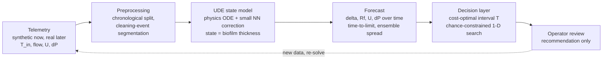

# Model Description

This document describes the modelling pipeline and how far it has been built.

> **Status labels.** **[EXISTS]** means the code is in this repository today.
> **[PROPOSED]** means it is designed here but not yet implemented. The UDE, its training and
> evaluation exist in `ml/` (see [ml/README.md](../ml/README.md) for full results). The decision
> layer exists as a deterministic re-simulation sweep; the UDE first-cycle risk is computed
> (`ml/forecast.risk_by_interval`) and used by the dashboard, but is not wired into
> `optimizer/cleaning_optimizer.py`. Section 9 has the full status table.

All data is synthetic. See [problem_statement.md](problem_statement.md) for scope and limitations.

---

## 1. Overview



The idea: keep the parts of fouling physics that are well understood (heat conduction, pipe
friction, the cleaning reset), and use a small neural network **only** for the part that is
uncertain, namely how fast biofilm deposits under given conditions. Then use the model's forecast,
including its uncertainty, to choose a cleaning interval.

## 2. State and physics

### State

The model has a single state variable: **biofilm thickness `delta`** (m). Everything the
instruments see is computed from it.

### Thermal **[EXISTS]** in `core/fouling_indicators.py`

```
Rf = delta / k_biofilm
1/U = 1/U_clean + Rf        ->   U = U_clean / (1 + U_clean * Rf)
Q  = U * A * dT_lm
```

### Hydraulic **[EXISTS]** in `fouling_indicators.compute_hydraulic_pressure_drop`

```
D_eff   = D_i - 2*delta                         (film narrows the tube)
v       = 4*m_dot / (rho * pi * N_tubes * D_eff^2)
Re      = rho * v * D_eff / mu
eps_eff = eps_clean + delta                     (film roughens the wall)
1/sqrt(f) = -1.8 * log10[ (eps_eff/D_eff / 3.7)^1.11 + 6.9/Re ]     (Haaland)
dP      = [ f * L/D_eff + K_minor ] * rho*v^2/2  (Darcy-Weisbach, K_minor = 1.2)
tau_w   = (f/8) * rho * v^2                     (wall shear stress)
```

### Biological growth factor **[EXISTS]** in `synthetic_generator.ratkowsky_growth_factor`

A cardinal-temperature function `r(T)` in [0, 1]: zero at or below `T_min`, 1 at `T_opt`, zero at
or above `T_max`.

### Constants used (from `core/config.py`)

| Name in `core/config.py` | Value | Meaning |
|---|---|---|
| `U_CLEAN_DESIGN_W_M2K` | 2200.0 W/m²K | clean overall coefficient |
| `BIOFILM_THERMAL_CONDUCTIVITY_W_MK` | 0.60 W/mK | `k_biofilm` |
| `BIOFILM_MAX_THICKNESS_M` | 350e-6 m | `delta_max` (asymptotic limit) |
| `TUBE_INNER_DIAMETER_M` | 0.021 m | `D_i` |
| `TUBE_LENGTH_M` | 6.0 m | `L` |
| `NUMBER_OF_TUBES` | 450 | `N_tubes` |
| `TOTAL_HEAT_TRANSFER_AREA_M2` | ~178.1 m² | `A` |
| `ROUGHNESS_CLEAN_M` | 1.5e-6 m | `eps_clean` |
| `COOLING_WATER_MASS_FLOW_KG_S` | 220.0 kg/s | nominal `m_dot` |
| `WATER_DENSITY_KG_M3`, `WATER_VISCOSITY_PA_S` | 998.0, 1.002e-3 | water properties |
| `T_BIO_MIN_C`, `T_BIO_OPT_C`, `T_BIO_MAX_C` | 6.0, 28.0, 45.0 °C | Ratkowsky cardinal temperatures |
| `K_DEPOSITION` | 1.6e-7 m/h | generator's deposition constant |
| `K_REMOVAL` | 4.2e-6 1/(Pa·h) | generator's shear-removal constant |
| `MECHANICAL_CLEANING_EFFICIENCY`, `CHEMICAL_BIOCIDE_EFFICIENCY` | 0.90, 0.95 | fraction removed per cleaning |
| `CRITICAL_RF_M2K_W` | 3.0e-4 m²K/W | thermal limit (equivalent to delta = 180 µm, U ≈ 1325 W/m²K) |
| `CRITICAL_DELTA_P_KPA` | 16.0 kPa | hydraulic limit (clean = 7.91 kPa) |
| `CRITICAL_BSI_SCORE` | 75.0 | severity-index limit |

For scale, at nominal flow a clean tube has v ≈ 1.41 m/s and tau_w ≈ 5.9 Pa. At the thermal
limit (180 µm), dP ≈ 13.2 kPa and tau_w ≈ 10.3 Pa.

## 3. The Universal Differential Equation **[EXISTS]** in `ml/ude.py`

### Equation

```
d(delta)/dt = K_dep * r(T) * g_theta(T, v, season, delta/delta_max, hours_since_cleaning)
                    * phi_lag(cum_clean_hours) * (1 - delta/delta_max)
              -  K_rem * tau_w(v) * delta
```

As implemented, the step mirrors `synthetic_generator.step()` exactly, including its lag phase
`phi_lag` (driven by `cum_clean_hours`, replayed from the maintenance log with the generator's
`max(24, 0.2 * cum)` memory rule) and carrying capacity. The one nominal-data term the physics
omits is the generator's seasonal nutrient factor `1 + 0.3 sin(phase)`; that is what `g_theta`
has to learn. With `g` set to that factor, true inputs and true `delta0`, the module reproduces
the generator's trajectory to `rtol 1e-9` (`tests/test_ml_ude.py`).

- `r(T)`: the existing Ratkowsky factor, a fixed physics prior.
- `g_theta`: a small neural network that **multiplies** the deposition term to correct what the
  simple physics gets wrong (nutrients, seasonal community changes, conditioning-film effects).
- `tau_w(v)`: wall shear from the Haaland/Darcy-Weisbach model above, a fixed physics term.

### The network `g_theta`

Five physical inputs, presented to the network as six numbers (season is encoded as sin/cos):

| Input | Normalisation fed to the network | Typical range |
|---|---|---|
| Water temperature `T` (°C) | `(T - T_BIO_MIN_C) / (T_BIO_MAX_C - T_BIO_MIN_C)` = `(T - 6) / 39` | about 0.05 to 0.6 |
| Tube velocity `v` (m/s) | `v / v_nom`, with `v_nom` = 1.414 m/s (clean tube at `COOLING_WATER_MASS_FLOW_KG_S`) | about 0.96 to 1.07 |
| Season, hour of year `t` | `sin(2*pi*t/8760)`, `cos(2*pi*t/8760)` | -1 to 1 |
| Relative thickness | `delta / BIOFILM_MAX_THICKNESS_M` (350e-6 m) | 0 to 1 |
| Hours since cleaning `h_c` | `h_c / 720`, clipped to [0, 1] | 0 to 1 |

```
inputs : 6 numbers (table above)
hidden : 2 layers x 16 units, tanh
output : linear layer, weights and bias initialised to zero
         g_theta(.) = exp(NN(.))   ->   g = 1 exactly at initialisation, and g > 0 always
```

About 400 parameters in total.

- **Where the inputs come from.** `T`, `v` and the season come from measurements and the clock,
  and `hours_since_cleaning` from the maintenance log. `delta/delta_max` is the model's **latent
  state**. In training it is rolled forward by the UDE itself, never read from the dataset. In real
  use it would come from a state estimator (for example a filter that assimilates measured U and dP).
- **Why these two extra inputs.** The generator's deposition depends on thickness (carrying
  capacity `1 - delta/delta_max`) and on time since cleaning (induction lag). Without these inputs,
  `g_theta` cannot represent either effect.
- **Physics stays the default.** Because the last layer starts at zero, **the untrained UDE equals
  the pure physics ODE**, and the L2 penalty `lambda * mean((g_theta - 1)^2)` (Section 5) keeps `g`
  near 1 unless the data needs otherwise (as implemented: `0.01 * mean((log g)^2)`). The
  exponential keeps deposition non-negative without clamping.
- **Overfitting risk.** More inputs mean more ways to fit noise, and a year contains only about 12
  cleaning cycles. Keep the network this small, and use the stress and mismatch datasets
  (Section 8) for validation, not only a slice of the nominal year.

### Learnable physics parameters

`K_dep` and `K_rem` are learned together with the network, **log-parameterised** so they stay
positive:

```
K_dep = exp(log_K_dep),   K_rem = exp(log_K_rem)
initial values: config.K_DEPOSITION, config.K_REMOVAL
```

### Integration

- Explicit Euler with an hourly step, matching the data rate:
  `delta[t+1] = clamp(delta[t] + dt * f(delta[t], inputs[t]), 0, delta_max)`.
- **Cleaning events** (known from the log) reset the state:
  `delta <- (1 - efficiency) * delta`, with efficiency 0.90 (mechanical) or 0.95 (chemical) from
  `core/config.py`.

## 4. Observation model **[EXISTS]** in `ml/physics_torch.py`

A differentiable PyTorch port of the existing `core/fouling_indicators.py` functions:

```
delta  ->  Rf = delta / k_biofilm  ->  U_hat  = U_clean / (1 + U_clean*Rf)
delta  ->  D_eff, v, Re, f         ->  dP_hat = Darcy-Weisbach (Section 2)
```

**The loss uses measured `U` and measured `dP` only, never `Rf`:**

```
L_obs = mean[ ((U_hat - U_meas) / sigma_U)^2 ] + mean[ ((dP_hat - dP_meas) / sigma_dP)^2 ]
```

- As implemented: Huber loss (delta = 1) on residuals standardised by `sigma_U` = 25 W/m²K and
  `sigma_dP` = 0.20 kPa (1.5% sensor noise plus about 2% from using the measured, 1%-noisy flow).
- Weighting each term by its sensor-noise scale stops either signal from dominating because of
  its units.

This removes the target-leakage shortcut (problem_statement.md, Section 6). The model is never
shown `Rf`, so it has to explain the measurements through the state `delta`. The test target `Rf`
is used for evaluation only.

The torch port matches the numpy functions to within 1e-5 relative error and passes
`torch.autograd.gradcheck` (`tests/test_ml_physics.py`).

## 5. Training **[EXISTS]** in `ml/train.py`

| Item | Choice | Reason |
|---|---|---|
| Scheme | Multiple shooting over 14-day windows (configurable 7–30), starting after each cleaning and every 24 h within cycles | Short windows stop errors compounding over a year |
| Initial state per window | Truth-free: median of the U- and dP-based inversions over a 12 h burn-in; loss only after the burn-in | No true `delta` is ever used |
| Stages | 1: ODE (g = 1), fit `K_dep`, `K_rem`; 2: UDE from the ODE fit, net LR 3e-3, K LR 3e-3, gradient clipping, early stopping on validation | Hyperparameters chosen on nominal validation only |
| Optimiser | Adam | Standard for small neural ODEs |
| Regularisation | weight decay on `theta`, plus `lambda * mean((g_theta - 1)^2)` | Keeps the correction small unless the data needs it |
| Split | Nominal year by whole cleaning cycles: train 0–7 (h 0–5758), validation 8–9 (h 5759–7198), test 10–12 (h 7199–8759) | No cycle straddles splits |
| Uncertainty | Ensemble of 5 seeds | Spread of the forecasts is used by the decision layer |
| Device | CPU float64: 101 ms per training step vs 314 ms on MPS (M4 Pro), measured by `ml/bench_device.py` | Tiny model: MPS launch overhead dominates |

## 6. Decision layer

**[EXISTS]** in `optimizer/cleaning_optimizer.py`: the shared cost function, forward re-simulation of any
cleaning policy, and the exact 1..90-day sweep, all using the generator's physics.
**[EXISTS]** outside the optimiser: the UDE first-cycle risk `P(limit crossed before T)`
(`ml/forecast.risk_by_interval`), applied with epsilon by the dashboard's `/api/decision`.
**[PROPOSED]**: putting the chance constraint and the UDE forecast inside `optimizer/cleaning_optimizer.py`.

### Cost per day for cleaning interval T (days)

```
          C_clean + C_downtime + integral_0^T [ c_pump(Rf(t)) + c_thermal(Rf(t)) ] dt
C(T)  =  ----------------------------------------------------------------------------
                                          T
```

| Term | Definition | `core/config.py` value |
|---|---|---|
| `C_clean` | cost per cleaning | `MECHANICAL_CLEANING_COST` = 3500 $ (chemical: 6500 $) |
| `C_downtime` | `DOWNTIME_HOURS_PER_CLEANING * DOWNTIME_COST_PER_HOUR` | 4 h x 250 $/h = 1000 $ |
| `c_pump` | `(dP - dP_clean) * V_dot / PUMP_EFFICIENCY * ELECTRICITY_COST_PER_KWH` | 0.75, 0.12 $/kWh |
| `c_thermal` | `(Q_clean - Q(U)) * THERMAL_PENALTY_COST_PER_MWH_LOSS`, `Q = U * A * DESIGN_LMTD_K` | 35 $/MWh, LMTD 14 K |

Implementation (`cost_breakdown`): mechanical cleanings cost `MECHANICAL_CLEANING_COST` and
chemical ones `CHEMICAL_CLEANING_COST`. `dP` and `Q` are evaluated from the simulated thickness at
nominal flow, so the penalties measure the effect of fouling only. One heat-duty definition
(`fouling_indicators.DESIGN_LMTD_K` = 14 K) is used everywhere. No other multipliers are applied.
Today `Rf(t)` comes from the generator's physics simulated forward. With the UDE it will come
from the forecast, starting at the post-cleaning state.

A policy is **feasible** if true Rf, true dP and BSI never exceed their limits, and biocide use
stays within `ANNUAL_BIOCIDE_PERMIT_LIMIT_KG` (pro-rated for windows shorter than a year).

### Constraints

```
P( Rf reaches CRITICAL_RF_M2K_W before T ) <= epsilon        (e.g. epsilon = 0.05)
max dP over [0, T]   <= CRITICAL_DELTA_P_KPA
max BSI over [0, T]  <= CRITICAL_BSI_SCORE
```

The probability is estimated from the 5-member ensemble. With five members this is coarse, so
the practical rule is "no ensemble member crosses the limit before T", and that rule should be
stated wherever results are reported.

### Solving it

**Exact 1-D search:** evaluate `C(T)` for every integer `T = 1 ... 90` days, discard infeasible
values, and pick the minimum. With the generator's physics, one simulated year takes about 0.1 s,
so a full sweep takes about 9 s. A torch UDE run in batch should be faster.

**Why not PSO (particle swarm optimisation)?** There is **one scalar decision variable** with a
small, bounded integer range. Exhaustive search is exact, deterministic and cheap, so a
metaheuristic adds randomness and tuning without any benefit. PSO or similar methods become useful
when there are **several coupled decisions**: for example cleaning method *and* timing *and*
biocide dose, or schedules for several exchangers that share a crew or an outage window. Then the
search space grows combinatorially.

### Rolling horizon

Re-solve each time new data arrives (for example daily). Update the state estimate from the latest
U and dP, re-forecast, and re-optimise. Only the next cleaning date is acted on.

### Operator authority

The output is a **recommendation**, shown with its cost breakdown and forecast uncertainty. It
supports the operator and never replaces operator authority, plant procedures or technical
specifications.

## 7. Baselines for comparison

| Baseline | Status | Notes |
|---|---|---|
| Persistence (Rf from the last 24 h of U) | [EXISTS] `ml/baselines.py` | Leak-free |
| Ridge, one per horizon, 24 h history features | [EXISTS] `ml/baselines.py` | Leak-free replacement for `legacy/baseline_model.py` |
| Gradient boosting, one per horizon | [EXISTS] `ml/baselines.py` | Leak-free replacement for `legacy/improved_model.py` |
| Plain fitted ODE (g = 1, `K_dep`, `K_rem` fitted) | [EXISTS] `ml/train.py` stage 1 | Shows what the neural correction adds |
| Physics-guided LSTM | [PROPOSED, optional] | Not built |
| Fixed 30-day schedule | [EXISTS] | Re-simulated, shared cost function |
| Best fixed interval (1..90 d sweep) | [EXISTS] | Stronger schedule baseline than fixed 30 d |
| Condition-based (clean at a fraction of the Rf/dP limits) | [EXISTS] | Idealised: triggers on the true simulated state |
| Never clean | [EXISTS] | Upper bound on fouling penalties |

## 8. Evaluation plan

### Datasets **[EXISTS]** in `db/` (regenerate with `python db/generate.py`)

| File | Use | Limits crossed |
|---|---|---|
| `biofouling_synthetic_dataset.csv` (seed 42) | training / validation / test, chronological | none |
| `stress_no_clean.csv` (seed 43) | constraint logic; long uncleaned growth | Rf, dP, BSI |
| `stress_long_interval.csv` (seed 44, 90-day cleaning) | constraint logic at long intervals | Rf, BSI |
| `mismatch_stress.csv` (seed 45, 60-day cleaning) | **held-out test only**: drift, scale term and bloom that the UDE structure lacks | Rf, dP, BSI |

### Forecast evaluation **[EXISTS]** in `ml/evaluate.py`

- **Leak-free target:** predict `Rf(t + h)` using only data up to time `t`. Inputs must not
  include `U` or `dP` measured after `t`, and same-time `U` must not be used as a regressor.
  The existing Ridge and Ridge+GBM baselines must be re-run on this target.
- **Horizons:** h = 1 h, 24 h, 72 h, 168 h.
- **Metrics:** MAE, RMSE, R² per horizon on Rf (vs truth) and on U, dP (vs measured); 90% band
  coverage; time-to-limit error against a 7-day linear trend.

**Results** (Rf RMSE, 1e-5 m²K/W, climatology inputs; full tables in `ml/README.md`):

| Dataset | Persistence 1 h / 168 h | ODE 1 h / 168 h | UDE 1 h / 168 h | UDE 90% coverage at 168 h |
|---|---|---|---|---|
| nominal test | **0.13** / 1.64 | 0.20 / 0.34 | 0.20 / **0.16** | 0.98 |
| stress_no_clean | **0.39** / 1.45 | 0.52 / 0.51 | 0.52 / **0.47** | 0.97 |
| stress_long_interval | **0.31** / 7.17 | 0.41 / 0.42 | 0.41 / **0.31** | 0.98 |
| mismatch_stress (held-out) | **0.38** / 8.99 | 0.43 / 2.28 | 0.43 / **2.21** | 0.64 |

Verdict:
- **Long horizons:** at 72–168 h the UDE has the lowest Rf error on every dataset. It is about 2x
  better than the ODE on nominal test, but only marginally better on the held-out mismatch set.
- **1 h:** persistence wins everywhere.
- **Calibration:** the UDE's bands are well calibrated on matched data and under-cover on mismatch.
- **Ridge and GBM:** they fail outside the nominal Rf range.
- **Time to limit:** fair for Rf; poor for dP with every method.
- **What `g` learned:** a seasonal multiplier (0.72 to 1.16) closely tracking the generator's
  nutrient factor.

### Mismatched test set **[EXISTS]**

If the UDE is tested on data from the same ODE that generated its training data, the test is too
easy. `mismatch_stress.csv` comes from the generator with mechanisms the UDE structure does not
contain (`synthetic_generator.GeneratorScenario`):

- `k_dep_drift = 0.5`: deposition rises linearly by 50% over the year;
- `scale_rate_m_per_h = 5e-9`: a slow, temperature-independent scale deposit;
- one bloom: deposition x3 for 504 h from hour 4300 (late June).

The UDE, baselines and schedules are all tested on this set without retraining on it.

### Schedule evaluation **[EXISTS for physics-based policies; PROPOSED for the UDE policy]**

`cleaning_optimizer.simulate_policy` simulates a full year under each policy **on the same
generator and the same noise sequence**, so each policy's own cleanings change the fouling that
follows. `CleaningScheduleOptimizer.compare_strategies` reports total cost and its four
components, cleanings by type, biocide kg, peak Rf/dP/BSI, hours above any limit, and
feasibility. The UDE-driven rolling-horizon policy will be added as a further row.

Current results (synthetic, generator physics, one year):

| Scenario | Fixed 30 d | Best fixed interval | Condition-based 0.8 x limits | Best condition-based | Never clean |
|---|---|---|---|---|---|
| Nominal (seed 42) | $259,120, feasible | 16 d: $217,817 | $331,068 | 0.55 x: $205,501 | $625,437, infeasible |
| Mismatch (seed 45) | $320,748, **infeasible** (383 h over a limit) | 14 d: $254,615 | $379,455 | 0.55 x: $235,139 | $669,983, infeasible |

The thermal penalty dominates the cost, so the optimum cleans about twice as often as fixed
30 d. That is a consequence of the illustrative cost constants, not a general finding.

## 9. Current implementation status

| Component | File | Status | Notes |
|---|---|---|---|
| Physical constants, thresholds, costs | `core/config.py` | EXISTS | |
| Synthetic data generator | `core/synthetic_generator.py` | EXISTS | One-hour `step()` function, pluggable cleaning policy, optional `GeneratorScenario` (drift, scale, blooms); default cleans every 720 h, alternating mechanical/chemical |
| Stress and mismatch datasets | `db/generate.py` | EXISTS | Four files, fixed seeds, byte-reproducible |
| Thermal and hydraulic physics (numpy) | `core/fouling_indicators.py` | EXISTS | |
| Chronological splits, feature pipeline | `legacy/preprocessor.py` | EXISTS | Features include same-time `U`, so the target leaks (below) |
| Ridge baseline | `legacy/baseline_model.py` | EXISTS | Predicts same-time `Rf` from same-time `U`; not a forecast |
| Ridge + GBM hybrid | `legacy/improved_model.py` | EXISTS | Same leakage; its multi-step "forecast" holds the last `Rf` constant |
| Shared cost function | `cleaning_optimizer.cost_breakdown` | EXISTS | `core/config.py` constants only |
| Policy re-simulation | `cleaning_optimizer.simulate_policy` | EXISTS | Fixed interval, condition-based, never clean, immediate once |
| Strategy comparison | `CleaningScheduleOptimizer.compare_strategies` | EXISTS | See Section 8 |
| Interval optimiser (exact 1..90 d sweep) | `CleaningIntervalOptimizer.optimize_interval` | EXISTS | Deterministic, uses generator physics; **does not use any ML forecast** yet |
| Sustainability accounting | `optimizer/sustainability_metrics.py` | EXISTS | |
| Torch physics and observation model | `ml/physics_torch.py` | EXISTS | numpy parity < 1e-5, gradcheck |
| UDE (`g_theta`, learnable `K_dep`, `K_rem`) | `ml/ude.py` | EXISTS | Reproduces the generator exactly with g = nutrient factor |
| Multiple-shooting training, 5-seed ensemble | `ml/train.py`, `ml/artifacts/` | EXISTS | Fitted K_dep 1.76–1.83e-7, K_rem 3.5–3.7e-7 (config 1.6e-7, 4.2e-6) |
| Leak-free baselines and multi-horizon evaluation | `ml/baselines.py`, `ml/evaluate.py` | EXISTS | `ml/artifacts/metrics.json` |
| Forecast API, first-cycle risk, g slices | `ml/forecast.py` | EXISTS | Used by the dashboard (`web/`) |
| Chance constraint inside `optimizer/cleaning_optimizer.py` | — | PROPOSED | TODO marked in `CleaningIntervalOptimizer`; the dashboard combines both |

**About the existing ML models.** They use same-time `U_overall_meas` as an input to predict
same-time `Rf_fouling_resistance`. Because `Rf = 1/U - 1/U_clean`, their R² of about 0.91–0.93
mostly measures how well they invert that formula through the sensor noise. It is not forecasting
skill.

## 10. Repository layout and known limitations

### Layout

```
core/config.py                  constants, thresholds, costs
core/synthetic_generator.py     synthetic dataset generator
core/fouling_indicators.py      thermal and hydraulic physics
legacy/preprocessor.py            splits and features
legacy/baseline_model.py          Ridge baseline
legacy/improved_model.py          Ridge + GBM baseline
optimizer/cleaning_optimizer.py      cost function, policy re-simulation, strategy comparison, interval sweep
optimizer/sustainability_metrics.py  energy, CO2e, biocide accounting
main.py                    end-to-end run
tests/                     unit tests
db/                        nominal, stress and mismatch datasets, and generate.py
docs/                      this document and the problem statement
```

### Known limitations

- **Synthetic data only.** No plant validation of any kind.
- **Nominal LMTD.** `DESIGN_LMTD_K` = 14 K is a fixed design value. The generator's own stream
  temperatures (process side 48 °C, cooling water 9–27 °C) imply a larger, seasonally varying
  LMTD, which the simulator does not resolve.
- **BSI uses measured dP.** Sensor noise can push BSI over its limit on a single hour, which
  makes near-limit states (e.g. 170 µm in summer) infeasible immediately.
- **Idealised condition-based policy.** It triggers on the true simulated state, not on noisy
  measurements, so it is an upper bound on what a real condition-based rule could achieve.
- **Lumped 1-D model:** uniform film thickness, constant `k_biofilm`, a single representative
  tube.
- **Coarse uncertainty:** 5 members x 3 initial states (15 trajectories) cannot estimate small
  exceedance probabilities, and the bands miss mechanisms the model lacks (mismatch coverage 0.64
  at 168 h).
- **`K_rem` is practically unidentifiable from nominal data.** Both models fit it about 12x
  below config: with cleaning every 30 days, removal is about 2% of deposition. This mainly
  degrades forecasts near the carrying capacity, such as time to the dP limit.
- **Illustrative costs:** values in `core/config.py` are not plant data.

### Known issues resolved in this iteration

- **Cleaning-type bug fixed.** The generator chose the type by hour parity, and its 720 h
  trigger always fires on an odd hour, so every cleaning was chemical (12 x 15 kg = 180 kg
  biocide). The default policy now alternates by cleaning number (6 mechanical, 6 chemical,
  90 kg).
- **Old savings figure invalid and removed.** The earlier "78.7% cost reduction" of
  condition-based over fixed 30-day cleaning is **invalid and must not be quoted**. Both old
  evaluators priced the dataset's own trajectory (generated under a different, 720 h schedule)
  instead of re-simulating their own cleanings, and they used hand-set multipliers (`* 1.2`,
  `* 1.1`, `* 0.75`, `* 0.15`, 3.5 vs 2.8 MW) and left out downtime. All strategies are now
  re-simulated and priced by one cost function (Section 6).
- **Limits never reached in nominal data.** In the nominal year Rf peaks at 2.0e-4 (limit
  3.0e-4), dP at 12.1 kPa (limit 16) and BSI at 57 (limit 75). Stress and mismatch datasets that
  do cross the limits were added (Section 8).
- **Network inputs.** `g_theta` now also sees `delta/delta_max` and `hours_since_cleaning`
  (Section 3), so it can represent the carrying-capacity and induction effects.
- **`K_REMOVAL` unit label.** Corrected in `core/config.py` from m/(Pa·h) to 1/(Pa·h), the
  dimensionally consistent unit in `K_REMOVAL * tau_w * delta`. The value is unchanged.
- **One LMTD.** All heat-duty calculations use `fouling_indicators.DESIGN_LMTD_K` = 14 K. The
  unused 12 K default was removed; no dataset changed.
