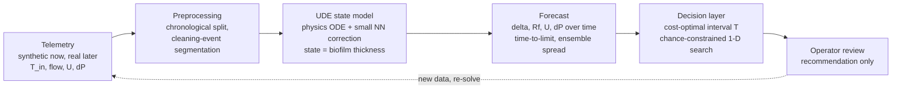

# Model Description

This document describes the proposed modelling pipeline and how far it has been built.

> **Status labels.** **[EXISTS]** means the code is in this repository today.
> **[PROPOSED]** means it is designed here but not yet implemented. Everything about the
> Universal Differential Equation (UDE), its training and the new decision layer is **[PROPOSED]**.
> Section 9 has the full status table.

All data is synthetic. See [problem_statement.md](problem_statement.md) for scope and limitations.

---

## 1. Overview



The idea: keep the parts of fouling physics that are well understood (heat conduction, pipe
friction, the cleaning reset), and use a small neural network **only** for the part that is
uncertain, namely how fast biofilm deposits under given conditions. Then use the model's forecast,
including its uncertainty, to choose a cleaning interval.

## 2. State and physics

### State

The model has a single state variable: **biofilm thickness `delta`** (m). Everything the
instruments see is computed from it.

### Thermal **[EXISTS]** in `fouling_indicators.py`

```
Rf = delta / k_biofilm
1/U = 1/U_clean + Rf        ->   U = U_clean / (1 + U_clean * Rf)
Q  = U * A * dT_lm
```

### Hydraulic **[EXISTS]** in `fouling_indicators.compute_hydraulic_pressure_drop`

```
D_eff   = D_i - 2*delta                         (film narrows the tube)
v       = 4*m_dot / (rho * pi * N_tubes * D_eff^2)
Re      = rho * v * D_eff / mu
eps_eff = eps_clean + delta                     (film roughens the wall)
1/sqrt(f) = -1.8 * log10[ (eps_eff/D_eff / 3.7)^1.11 + 6.9/Re ]     (Haaland)
dP      = [ f * L/D_eff + K_minor ] * rho*v^2/2  (Darcy-Weisbach, K_minor = 1.2)
tau_w   = (f/8) * rho * v^2                     (wall shear stress)
```

### Biological growth factor **[EXISTS]** in `synthetic_generator.ratkowsky_growth_factor`

A cardinal-temperature function `r(T)` in [0, 1]: zero at or below `T_min`, 1 at `T_opt`, zero at
or above `T_max`.

### Constants used (from `config.py`)

| Name in `config.py` | Value | Meaning |
|---|---|---|
| `U_CLEAN_DESIGN_W_M2K` | 2200.0 W/m²K | clean overall coefficient |
| `BIOFILM_THERMAL_CONDUCTIVITY_W_MK` | 0.60 W/mK | `k_biofilm` |
| `BIOFILM_MAX_THICKNESS_M` | 350e-6 m | `delta_max` (asymptotic limit) |
| `TUBE_INNER_DIAMETER_M` | 0.021 m | `D_i` |
| `TUBE_LENGTH_M` | 6.0 m | `L` |
| `NUMBER_OF_TUBES` | 450 | `N_tubes` |
| `TOTAL_HEAT_TRANSFER_AREA_M2` | ~178.1 m² | `A` |
| `ROUGHNESS_CLEAN_M` | 1.5e-6 m | `eps_clean` |
| `COOLING_WATER_MASS_FLOW_KG_S` | 220.0 kg/s | nominal `m_dot` |
| `WATER_DENSITY_KG_M3`, `WATER_VISCOSITY_PA_S` | 998.0, 1.002e-3 | water properties |
| `T_BIO_MIN_C`, `T_BIO_OPT_C`, `T_BIO_MAX_C` | 6.0, 28.0, 45.0 °C | Ratkowsky cardinal temperatures |
| `K_DEPOSITION` | 1.6e-7 m/h | generator's deposition constant |
| `K_REMOVAL` | 4.2e-6 | generator's shear-removal constant (see limitations) |
| `MECHANICAL_CLEANING_EFFICIENCY`, `CHEMICAL_BIOCIDE_EFFICIENCY` | 0.90, 0.95 | fraction removed per cleaning |
| `CRITICAL_RF_M2K_W` | 3.0e-4 m²K/W | thermal limit (equivalent to delta = 180 µm, U ≈ 1325 W/m²K) |
| `CRITICAL_DELTA_P_KPA` | 16.0 kPa | hydraulic limit (clean = 7.91 kPa) |
| `CRITICAL_BSI_SCORE` | 75.0 | severity-index limit |

For scale, at nominal flow a clean tube has v ≈ 1.41 m/s and tau_w ≈ 5.9 Pa. At the thermal
limit (180 µm), dP ≈ 13.2 kPa and tau_w ≈ 10.3 Pa.

## 3. The Universal Differential Equation **[PROPOSED]**

### Equation

```
d(delta)/dt = K_dep * r(T) * g_theta(T, v, season)  -  K_rem * tau_w(v) * delta
              \_________ deposition ____________/      \___ shear removal ___/
```

- `r(T)`: the existing Ratkowsky factor, a fixed physics prior.
- `g_theta`: a small neural network that **multiplies** the deposition term to correct what the
  simple physics gets wrong (nutrients, seasonal community changes, conditioning-film effects).
- `tau_w(v)`: wall shear from the Haaland/Darcy-Weisbach model above, a fixed physics term.

### The network `g_theta`

```
inputs : T (scaled), v (scaled), sin(2*pi*t/8760), cos(2*pi*t/8760)
hidden : 2 layers x 16 units, tanh
output : linear layer, weights and bias initialised to zero
         g_theta(.) = 1 + NN(.)   ->   g = 1 exactly at initialisation
```

Because the last layer starts at zero, **the untrained UDE equals the pure physics ODE**. Training
can only move it away from physics if the data supports that. To keep deposition non-negative, the
output is clamped at `g >= 0`.

### Learnable physics parameters

`K_dep` and `K_rem` are learned together with the network, **log-parameterised** so they stay
positive:

```
K_dep = exp(log_K_dep),   K_rem = exp(log_K_rem)
initial values: config.K_DEPOSITION, config.K_REMOVAL
```

### Integration

- Explicit Euler with an hourly step, matching the data rate:
  `delta[t+1] = clamp(delta[t] + dt * f(delta[t], inputs[t]), 0, delta_max)`.
- **Cleaning events** (known from the log) reset the state:
  `delta <- (1 - efficiency) * delta`, with efficiency 0.90 (mechanical) or 0.95 (chemical) from
  `config.py`.

## 4. Observation model **[PROPOSED]**

A differentiable PyTorch port of the existing `fouling_indicators.py` functions:

```
delta  ->  Rf = delta / k_biofilm  ->  U_hat  = U_clean / (1 + U_clean*Rf)
delta  ->  D_eff, v, Re, f         ->  dP_hat = Darcy-Weisbach (Section 2)
```

**The loss uses measured `U` and measured `dP` only, never `Rf`:**

```
L_obs = mean[ ((U_hat - U_meas) / sigma_U)^2 ] + mean[ ((dP_hat - dP_meas) / sigma_dP)^2 ]
```

- `sigma_U ≈ 25 W/m²K` and `sigma_dP ≈ 1.5% of dP`, matching the noise the generator adds.
- Weighting each term by its sensor-noise scale stops either signal from dominating because of
  its units.

This removes the target-leakage shortcut (problem_statement.md, Section 6). The model is never
shown `Rf`, so it has to explain the measurements through the state `delta`. The test target `Rf`
is used for evaluation only.

The torch port will be checked against the existing numpy functions to within floating-point
tolerance before it is used.

## 5. Training **[PROPOSED]**

| Item | Choice | Reason |
|---|---|---|
| Scheme | Multiple shooting over 7–30 day windows, each starting right after a cleaning | Short windows stop errors compounding over a year; starting after a cleaning gives a well-known initial state |
| Initial state per window | `(1 - efficiency) * delta_before` from the previous window, or a learned per-window value | Handles the cleaning reset |
| Optimiser | Adam | Standard for small neural ODEs |
| Regularisation | weight decay on `theta`, plus `lambda * mean((g_theta - 1)^2)` | Keeps the correction small unless the data needs it |
| Split | Chronological train / validation / test, no shuffling | No future information in training |
| Uncertainty | Ensemble of 5 seeds | Spread of the forecasts is used by the decision layer |
| Device | CPU is enough (one state, ~1,000 parameters); Apple MPS optional | |

## 6. Decision layer **[PROPOSED]**

### Cost per day for cleaning interval T (days)

```
          C_clean + C_downtime + integral_0^T [ c_pump(Rf(t)) + c_thermal(Rf(t)) ] dt
C(T)  =  ----------------------------------------------------------------------------
                                          T
```

| Term | Definition | `config.py` value |
|---|---|---|
| `C_clean` | cost per cleaning | `MECHANICAL_CLEANING_COST` = 3500 $ (chemical: 6500 $) |
| `C_downtime` | `DOWNTIME_HOURS_PER_CLEANING * DOWNTIME_COST_PER_HOUR` | 4 h x 250 $/h = 1000 $ |
| `c_pump` | `(dP - dP_clean) * V_dot / PUMP_EFFICIENCY * ELECTRICITY_COST_PER_KWH` | 0.75, 0.12 $/kWh |
| `c_thermal` | `(Q_clean - Q(U)) * THERMAL_PENALTY_COST_PER_MWH_LOSS` | 35 $/MWh |

`Rf(t)` comes from the UDE forecast starting at the post-cleaning state.

### Constraints

```
P( Rf reaches CRITICAL_RF_M2K_W before T ) <= epsilon        (e.g. epsilon = 0.05)
max dP over [0, T]   <= CRITICAL_DELTA_P_KPA
max BSI over [0, T]  <= CRITICAL_BSI_SCORE
```

The probability is estimated from the 5-member ensemble. With five members this is coarse, so
the practical rule is "no ensemble member crosses the limit before T", and that rule should be
stated wherever results are reported.

### Solving it

**Exact 1-D search:** evaluate `C(T)` for every integer `T = 1 ... 90` days, discard infeasible
values, and pick the minimum. That is 90 forecasts of a one-state ODE, which takes well under a
second.

**Why not PSO (particle swarm optimisation)?** There is **one scalar decision variable** with a
small, bounded integer range. Exhaustive search is exact, deterministic and cheap, so a
metaheuristic adds randomness and tuning without any benefit. PSO or similar methods become useful
when there are **several coupled decisions**: for example cleaning method *and* timing *and*
biocide dose, or schedules for several exchangers that share a crew or an outage window. Then the
search space grows combinatorially.

### Rolling horizon

Re-solve each time new data arrives (for example daily). Update the state estimate from the latest
U and dP, re-forecast, and re-optimise. Only the next cleaning date is acted on.

### Operator authority

The output is a **recommendation**, shown with its cost breakdown and forecast uncertainty. It
supports the operator and never replaces operator authority, plant procedures or technical
specifications.

## 7. Baselines for comparison

| Baseline | Status | Notes |
|---|---|---|
| Persistence (`Rf(t+h) = Rf(t)`) | [PROPOSED] | Simplest reference; any useful model must beat it |
| Ridge regression (`baseline_model.py`) | [EXISTS] | Must be re-run on the leak-free target |
| Ridge + gradient boosting (`improved_model.py`) | [EXISTS] | Same |
| Plain fitted ODE (UDE with `g_theta` removed, only `K_dep`, `K_rem` fitted) | [PROPOSED] | Shows what the neural correction adds |
| Physics-guided LSTM | [PROPOSED, optional] | Only if time allows |
| Fixed 30-day schedule | [EXISTS, needs rework] | Schedule baseline for the decision layer |

## 8. Evaluation plan **[PROPOSED]**

### Forecast evaluation

- **Leak-free target:** predict `Rf(t + h)` using only data up to time `t`. Inputs must not
  include `U` or `dP` measured after `t`.
- **Horizons:** h = 1 h, 24 h, 72 h, 168 h.
- **Metrics:** MAE, RMSE, R² per horizon, and skill relative to persistence.

### Mismatched test set

If the UDE is tested on data from the same ODE that generated its training data, the test is too
easy. A **second synthetic dataset** will come from a deliberately different generator:

- `K_dep` drifts slowly through the year (for example, changing water quality);
- an extra **scale-deposition term** not present in the UDE structure;
- a **bloom event**: a few weeks of strongly increased deposition.

The UDE, baselines and schedules are all tested on this set without retraining on it.

### Schedule evaluation

Simulate a full year under each policy (fixed 30-day, and the UDE-based rolling-horizon interval)
**on the same generator**, so each policy's cleanings actually change the fouling that follows.
Report total cost, number of cleanings, downtime, pumping energy, CO2e, biocide use against the
permit, and constraint violations.

## 9. Current implementation status

| Component | File | Status | Notes |
|---|---|---|---|
| Physical constants, thresholds, costs | `config.py` | EXISTS | |
| Synthetic data generator | `synthetic_generator.py` | EXISTS | Deposition includes nutrient, induction and carrying-capacity factors; cleans every 720 h or at 230 µm |
| Thermal and hydraulic physics (numpy) | `fouling_indicators.py` | EXISTS | |
| Chronological splits, feature pipeline | `preprocessor.py` | EXISTS | Features include same-time `U`, so the target leaks (below) |
| Ridge baseline | `baseline_model.py` | EXISTS | Predicts same-time `Rf` from same-time `U`; not a forecast |
| Ridge + GBM hybrid | `improved_model.py` | EXISTS | Same leakage; its multi-step "forecast" holds the last `Rf` constant |
| Scenario cleaning-interval optimiser | `cleaning_optimizer.py` | EXISTS | Re-simulates the generator's own physics; **does not use any ML forecast** |
| Fixed vs condition-based comparison | `cleaning_optimizer.py` | EXISTS, not reliable | The condition-based path does not re-simulate fouling after its own cleanings and uses hand-set multipliers (e.g. `* 0.75`, `2.8` vs `3.5` MW); its savings figure should not be quoted |
| Sustainability accounting | `sustainability_metrics.py` | EXISTS | |
| Torch observation model | — | PROPOSED | |
| UDE (`g_theta`, learnable `K_dep`, `K_rem`) | — | PROPOSED | |
| Multiple-shooting training, 5-seed ensemble | — | PROPOSED | |
| Leak-free multi-horizon evaluation | — | PROPOSED | |
| Mismatched synthetic dataset | — | PROPOSED | |
| 1-D chance-constrained interval search | — | PROPOSED | Replaces the current optimiser |

**About the existing ML models.** They use same-time `U_overall_meas` as an input to predict
same-time `Rf_fouling_resistance`. Because `Rf = 1/U - 1/U_clean`, their R² of about 0.91–0.93
mostly measures how well they invert that formula through the sensor noise. It is not forecasting
skill.

## 10. Repository layout and known limitations

### Layout

```
config.py                  constants, thresholds, costs
synthetic_generator.py     synthetic dataset generator
fouling_indicators.py      thermal and hydraulic physics
preprocessor.py            splits and features
baseline_model.py          Ridge baseline
improved_model.py          Ridge + GBM baseline
cleaning_optimizer.py      current optimiser (to be replaced)
sustainability_metrics.py  energy, CO2e, biocide accounting
main.py                    end-to-end run
tests/                     unit tests
docs/                      this document and the problem statement
```

### Known limitations

- **Synthetic data only.** No plant validation of any kind.
- **Limits are never reached in the current dataset.** In the seed-42 dataset the generator's own
  ~30-day cleaning keeps Rf at or below about 2.0e-4 (limit 3.0e-4), dP at or below about
  12.3 kPa (limit 16) and BSI at or below about 57 (limit 75). Constraint handling therefore
  needs scenarios with longer intervals or faster growth to be tested at all.
- **Structural mismatch is built in.** The generator's deposition also depends on thickness
  (carrying capacity `1 - delta/delta_max`) and on time since cleaning (induction lag). The
  proposed `g_theta(T, v, season)` sees neither directly. It may need `delta/delta_max` and
  time-since-cleaning as extra inputs. This is an open design choice.
- **Units of `K_REMOVAL`.** `config.py` labels it m/(Pa·h), but in `K_REMOVAL * tau_w * delta`
  the dimensionally consistent unit is 1/(Pa·h). The value is unaffected; only the label is wrong.
- **Inconsistent LMTD.** The generator uses dT_lm = 14 K for heat duty, while the default in
  `compute_heat_duty_mw` is 12 K. The decision layer must use one value consistently.
- **Lumped 1-D model:** uniform film thickness, constant `k_biofilm`, a single representative
  tube.
- **Coarse uncertainty:** a 5-member ensemble cannot estimate small exceedance probabilities.
- **Illustrative costs:** values in `config.py` are not plant data.
